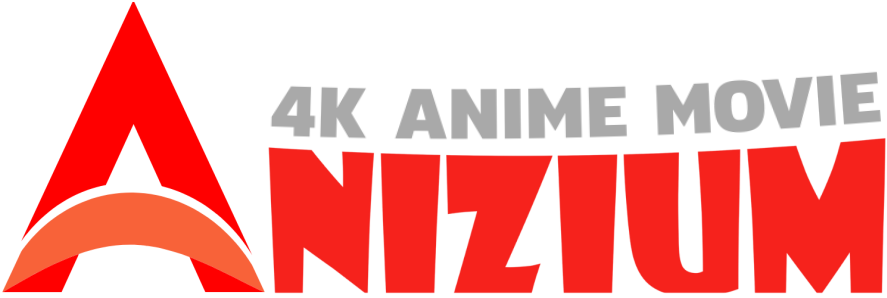
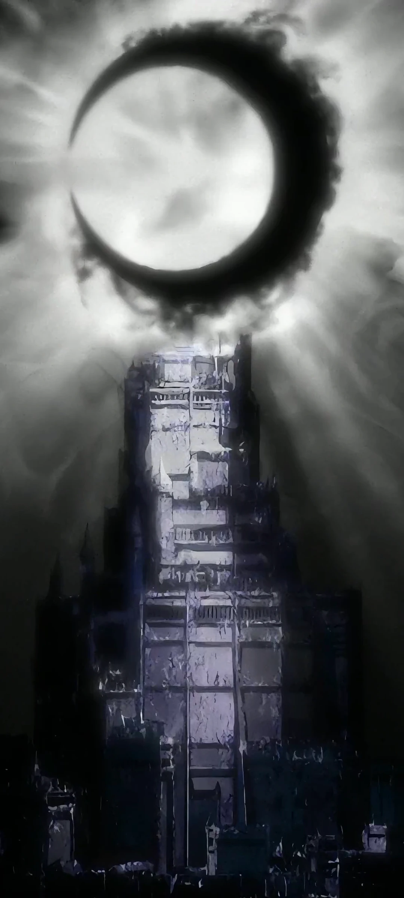
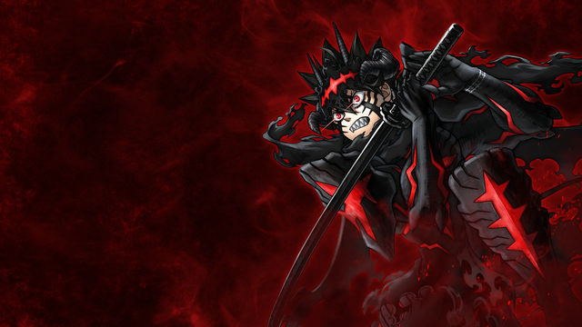
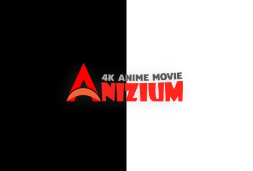

<div align="center">

  

  <br />

  

  <p align="center">
    <b>Modern, Hızlı ve Donanım Hızlandırmalı Evrensel Apple İstemcisi</b><br />
    <i>iPhone • iPad • Mac (Apple Silicon) • Apple Vision Pro</i>
  </p>

  <p align="center">
    <a href="https://github.com/emirdolmaci/anizium-ios/releases/latest"></a>
    <a href="https://swift.org"></a>
    <a href="https://developer.apple.com/xcode/"></a>
    <a href="LICENSE"></a>
  </p>

  <p align="center">
    <a href="https://github.com/emirdolmaci/anizium-ios/releases/download/v2.2.0/Anizium.ipa">
      
    </a>
    &nbsp;
    <a href="https://github.com/emirdolmaci/anizium-ios/releases/download/v2.2.0/Anizium.dmg">
      
    </a>
  </p>

</div>

---

## 📱 Cihaz Deneyimi & Tasarım

Anizium iOS; telefon, tablet ve masaüstü Apple cihazlarının her birinin ekran dinamiklerine uyum sağlayan özel uyarlanabilir (`adaptive`) ızgara altyapısıyla geliştirilmiştir.

<div align="center">
  <table border="0">
    <tr>
      <td align="center" width="50%">
        <b>📱 iPhone Arayüzü</b><br/><br/>
        <br/>
        <i>Tek el optimize, akıcı gezinme & dikey liste akışı</i>
      </td>
      <td align="center" width="50%">
        <b>💻 iPad & Mac Arayüzü</b><br/><br/>
        <br/>
        <i>Stage Manager, Split View ve geniş katalog ızgarası</i>
      </td>
    </tr>
  </table>
</div>

---

## 🎬 Öne Çıkan Başlıklar & Akış Vitrini

Doğrudan [anizium.co](https://anizium.co) resmi içerik dağıtım ağı (CDN) üzerinden 1080p & 4K yüksek kaliteli görseller ve yayın akışı çekilir:

<div align="center">
  <table>
    <tr>
      <td width="50%">
        <br/>
        <b>Bleach: Thousand-Year Blood War</b>
      </td>
      <td width="50%">
        <br/>
        <b>Blue Box</b>
      </td>
    </tr>
    <tr>
      <td width="50%">
        <br/>
        <b>Ao Ashi</b>
      </td>
      <td width="50%">
        <br/>
        <b>Black Clover</b>
      </td>
    </tr>
  </table>
</div>

---

## ⚡ Temel Yetenekler

### 1. 🔐 Resmi anizium.co Altyapısı & Uçtan Uca Şifreleme
- **Özel İstemci Anahtarı**: Tüm oturum, profil ve etkileşim istekleri tersine mühendislikle çözümlenen `16ghkdz5qnwinkyebwopbd94b49xhs` istemci anahtarı ile şifrelenir.
- **Dinamik Cf-Control**: Günün saat ve timezone (`Europe/Istanbul`) değerlerine göre türetilen güvenli el sıkışma başlığı.
- **Oturum Sürekliliği**: Token ve aktif profil ID'si Keychain ve UserDefaults üzerinde güvenle saklanır.

### 2. 👤 "Kim İzliyor?" Çoklu Profil Seçimi ve Yönetimi
- `https://anizium.co/profiles` sayfasının tam native SwiftUI eşdeğeri.
- Tek dokunuşla profil değiştirme, yeni profil ekleme, profil ismi güncelleme ve profil silme.
- Animasyonlu GIF profil avatarları ve aktif profile özel izleme geçmişi.

### 3. 🎥 Donanım Hızlandırmalı Oynatıcı & Canlı Altyazı Özelleştirici
- **Otomatik PiP (Picture-in-Picture)**: Anime izlerken uygulamayı arka plana attığınızda veya ana ekrana döndüğünüzde video kesilmez; ekranın köşesinde pop-up pencere olarak oynamaya devam eder.
- **Kişiselleştirilebilir Altyazı Ayarları**:
  - **Yazı Boyutu**: `14pt` ile `26pt` arasında serbest kaydırıcı.
  - **Renk Paleti**: Sarı (`#FFD700`), Beyaz (`#FFFFFF`), Camgöbeği (`#00FFFF`), Yeşil (`#00FF88`).
  - **Arka Plan Modları**: Yarı Saydam Siyah Kutu, Opak Siyah Kutu veya Kutusuz Metin Gölgesi.
  - **Dikey Ofset**: Standart alt konum veya altyazıyı +30pt yukarı taşıma seçeneği.
  - Canlı önizleme penceresi ve anında sıfırlama butonu.
- **İntro Atlama & Sonraki Bölüm**: Bölüm sonlarında tek dokunuşla sonraki bölüme geçiş.

<div align="center">
  <br/>
  <i>Oynatıcı içi canlı altyazı özelleştirme arayüzü</i>
</div>

### 4. 🎛️ Profesyonel Oynatıcı Jestleri & Akıllı Denetimler
- **Çift Dokunma ile Sarma**: Sol kenara çift dokunuşla `-10sn`, sağ kenara çift dokunuşla `+10sn` hassas geri/ileri sarma ve haptik titreşim destekli dinamik HUD dalgası.
- **Kenar Kaydırma Hareketi (Parlaklık & Ses)**: Sol kenarda dikey kaydırma ile ekran parlaklığı, sağ kenarda dikey kaydırma ile ses düzeyi ayarı ve anlık yüzdelik gösterge.
- **Hızlı Bölüm Çekmecesi**: Oynatıcıyı kapatmaya gerek kalmadan, tek dokunuşla sezonun tüm bölümlerini listeleyen yan çekmece üzerinden anında bölüm değiştirme.
- **Tek Tıkla Ekran Kilidi**: İstenmeyen dokunmaları engelleyen ve tek dokunuşla kontrolleri gizleyen akıllı kilit mekanizması.

### 5. ⬇️ Çevrimdışı İndirme & İnternetsiz İzleme (Premium)
- **Cihaza Yerel Kayıt**: Anizium Premium üyelerine özel, bölümleri yerel hafızaya kaydedip metroda, uçakta veya internetsiz her ortamda kesintisiz izleme olanağı.
- **Listem & İndirilenler Sekmesi**: İndirilen bölümleri dosya boyutlarıyla listeleme, anında yerel oynatma veya depolama alanı temizleme.
- **Yetkisiz Erişim Koruması**: Premium üye olmayan kullanıcılara indirme kilitli olup Premium paketleri tanıtılır.

### 6. 📅 Canlı Yayın Takvimi
- Haftanın günlerine göre anlık yayın akışı (`api.anizium.co/page/calendar`).
- Yeni bölümler sunucuya yüklendiği anda takvimde otomatik listelenir.

### 7. 🔍 Akıllı Keşfet & 300ms Debounce Arama
- Milyonlarca anime, film ve dizi içinde harf yazdıkça anlık sorgulama.
- Sunucuyu gereksiz isteklerden koruyan 300ms akıllı gecikme filtresi.

### 8. 👑 Premium Üyelik Planları & Rozetler
- `anizium.co/premium` sistemiyle senkronize; 1 Ay, 3 Ay, 6 Ay, 1 Yıl ve Sınırsız üyelik tipleri.
- Kalan gün sayacı ve hediye kodu (Gift Code) aktivasyonu.

---

## 🛠️ Kurulum Rehberi (Sideloading & DMG)

### Yöntem 1: 3uTools ile IPA Yükleme (Önerilen - Windows / Mac) 🚀

3uTools, ücretsiz kişisel Apple ID hesabınızla IPA dosyasını imzalayıp cihazınıza kurmanın en hızlı yoludur.

```
[İndir: Anizium.ipa] ➜ [3uTools Araçlar] ➜ [IPA İmzala] ➜ [Apple ID Ekle] ➜ [Cihaza Yükle]
```

1. **3uTools'u Hazırlayın**: [3uTools Resmi Sitesinden](http://www.3u.com/) programı kurun ve açın.
2. **Cihazı Bağlayın**: iPhone veya iPad'inizi USB kablosuyla bilgisayara bağlayın. Ekranda çıkan **"Bu Bilgisayara Güven"** uyarısını onaylayıp kilit parolanızı girin.
3. **İmza Aracına Geçin**: Üst menüden **Araçlar (Toolbox)** sekmesine tıklayın, açılan listeden **IPA İmzala (IPA Signature)** aracını açın.
4. **IPA Dosyasını Ekleyin**: **IPA Ekle (Add IPA)** butonuna basarak bilgisayarınıza indirdiğiniz [Anizium.ipa](https://github.com/emirdolmaci/anizium-ios/releases/download/v2.2.0/Anizium.ipa) dosyasını seçin.
5. **Apple ID Tanımlayın**:
   * **"Apple Kimliği ile İmzala (Sign with Apple ID)"** kutucuğunu işaretleyin.
   * **Apple ID Ekle** butonuna basarak kendi Apple ID e-postanızı ve parolanızı yazın (Ücretsiz bireysel hesap geçerlidir, ücretli geliştirici hesabı gerekmez).
6. **İmzalamayı Başlatın**: Listeden `Anizium.ipa`'yı ve Apple ID'nizi seçip sağ alttaki yeşil **İmzalamayı Başlat (Start Signing)** butonuna tıklayın. Durum çubuğunda *"İmzalama Başarılı"* yazısını bekleyin.
7. **Cihaza Aktarın**: 3uTools ana ekranındaki **Uygulamalar (Apps)** sekmesine gelin veya imzalanan dosyaya sağ tıklayıp **Cihaza Yükle (Install)** butonuna basın. Uygulama telefonunuza yüklenecektir.
8. **Cihaz Üzerinden Güven Onayı Verin (Önemli)**:
   * iOS Cihazınızda **Ayarlar** -> **Genel** -> **VPN ve Aygıt Yönetimi** menüsüne gidin.
   * *Geliştirici Uygulaması* altında kendi Apple ID'nize dokunun ve **"Güven"** seçeneğini onaylayın.
   * *(iOS 16 ve üzeri için)*: **Ayarlar** -> **Gizlilik ve Güvenlik** -> En alttaki **Geliştirici Modu**'nu aktif edip cihazı yeniden başlatın.
   * **Anizium** ana ekranınızda kullanıma hazırdır!

---

### Yöntem 2: AltStore / SideStore ile Kurulum (Kablosuz & Otomatik Yenileme)

1. Cihazınızda AltStore yüklü ve bilgisayarınızda AltServer çalışıyor olsun.
2. Safari üzerinden [Anizium.ipa](https://github.com/emirdolmaci/anizium-ios/releases/download/v2.2.0/Anizium.ipa) dosyasını indirin.
3. AltStore -> **My Apps** sekmesine gelin, sol üstteki **"+"** ikonuna basıp dosyayı seçin.
4. Kurulum bittiğinde uygulama 7 gün boyunca çalışır ve ev Wi-Fi ağınızdayken arka planda otomatik yenilenir.

---

### Yöntem 3: Sideloadly ile Kurulum (Windows / Mac)

1. [Sideloadly](https://sideloadly.io/) uygulamasını açın ve cihazınızı USB ile bağlayın.
2. `Anizium.ipa` dosyasını sol taraftaki alana sürükleyip bırakın.
3. Apple ID bilgilerinizi girip **Start** butonuna basın.
4. Cihazınızda **Ayarlar** -> **Genel** -> **VPN ve Aygıt Yönetimi** adımlarından sertifikayı onaylayın.

---

### Yöntem 4: TrollStore ile Kurulum (Kalıcı & Süresiz)

*TrollStore destekleyen iOS sürümlerinde (iOS 14.0 - 16.6.1 / 17.0):*
1. [Anizium.ipa](https://github.com/emirdolmaci/anizium-ios/releases/download/v2.2.0/Anizium.ipa) dosyasını indirin.
2. Paylaş menüsünden TrollStore'u seçin ve **Install** butonuna dokunun.
3. 7 gün süresi olmadan, kalıcı ve imzasız olarak çalışır.

---

### Yöntem 5: macOS Apple Silicon (M1 / M2 / M3 / M4) Kurulumu 💻

1. [Anizium.dmg](https://github.com/emirdolmaci/anizium-ios/releases/download/v2.2.0/Anizium.dmg) dosyasını indirin ve çift tıklayarak açın.
2. `Anizium.app` ikonunu `Applications` (Uygulamalar) klasörüne sürükleyin.
3. İlk açılışta Gatekeeper uyarısı alırsanız Terminal uygulamasında şu komutu çalıştırın:
   ```bash
   xattr -cr /Applications/Anizium.app
   ```
   veya **Sistem Ayarları** -> **Gizlilik ve Güvenlik** -> **"Yine de Aç"** butonuna tıklayın.

---

## 🏗️ Kaynak Kod Hiyerarşisi

```text
Anizium-iOS/
├── assets/                              # Dökümantasyon görselleri, mockup'lar ve animasyonlar
│   ├── anizium_intro.gif                # Hareketli Anizium logo animasyonu
│   ├── anizium_logo.png                 # Yüksek çözünürlüklü vektör logo
│   ├── phone_mockup.png                 # iPhone cihaz arayüzü mockup'ı
│   ├── tablet_mockup.png                # iPad / Mac geniş ekran mockup'ı
│   └── caption_preview.png              # Altyazı özelleştirme önizleme grafiği
├── Anizium/
│   ├── AniziumApp.swift                 # SwiftUI Lifecycle ve sahne giriş noktası
│   ├── Info.plist                       # Cihaz izinleri, UIDeviceFamily (1,2) ve yönelimler
│   ├── Models/
│   │   └── AniziumModels.swift          # Anime, Bölüm, Profil, Yorum, Takvim veri modelleri
│   ├── Services/
│   │   ├── AniziumAPI.swift             # Uçtan uca şifreli anizium.co HTTP API istemcisi
│   │   ├── AuthManager.swift            # Oturum, Keychain, aktif profil yöneticisi
│   │   └── ImageCacheService.swift      # RAM & Disk bazlı iki kademeli görsel önbellek
│   └── Views/
│       ├── MainTabView.swift            # 5 sekmeli modern alt navigasyon barı
│       ├── HomeView.swift               # Karusel, devam et listesi, özel koleksiyonlar
│       ├── SearchView.swift             # Keşfet ve anlık arama motoru
│       ├── CalendarView.swift           # Canlı yayın takvimi sekmesi
│       ├── WatchlistView.swift          # İzleme listesi ve favoriler
│       ├── AnimeDetailView.swift        # Anime detayları, bölüm listeleri, yorumlar
│       ├── PlayerView.swift             # AVPlayer, otomatik PiP, altyazı özelleştirici
│       ├── ProfileSelectionView.swift   # "Kim İzliyor?" çoklu profil yönetimi
│       ├── SettingsView.swift           # Hesap, profil geçişi, premium durumu
│       ├── Auth/LoginSheetView.swift    # anizium.co giriş yapma modalı
│       └── Components/                  # Yeniden kullanılabilir UI bileşenleri
├── Anizium.xcodeproj/                   # Xcode Proje Dosyası
├── .github/workflows/build-ipa.yml      # Otomatik IPA ve DMG derleme CI/CD hattı
├── LICENSE                              # MIT Açık Kaynak Lisansı
└── README.md                            # Dökümantasyon
```

---

## 👨‍💻 Geliştirici & Yapan

**Emir DOLMACI** — [@emirdolmaci](https://github.com/emirdolmaci)

---

## ⚖️ Lisans

Bu proje **MIT Lisansı** altında **Emir DOLMACI** tarafından lisanslanmıştır. Detaylar için [LICENSE](LICENSE) dosyasına bakabilirsiniz.  
Tüm anime içerikleri, görseller ve video akış hakları [anizium.co](https://anizium.co) platformuna aittir.
